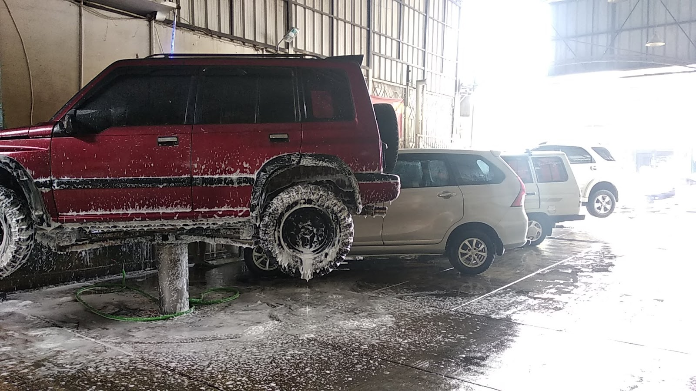

Setelah dicuci, mobil bisa tampak mengkilap di bagian luar, tapi begitu naik ramp atau dilihat dari bawah, kolongnya masih penuh lumpur dan debu jalan. Ini yang tidak bisa diselesaikan cuci biasa. Untuk bagian bawah mobil, dibutuhkan cuci hidrolik, layanan yang menjadi andalan kami sejak awal di Sinar Surya Auto Care.

## Apa Itu Cuci Mobil Hidrolik?

Cuci mobil hidrolik adalah pencucian yang menggunakan **lift hidrolik** untuk mengangkat mobil beberapa puluh sentimeter dari lantai. Begitu bagian bawah terbuka, pekerja bisa menyemprot dan membersihkan area yang pada cuci biasa tidak tersentuh:

- Kolong atau bagian bawah sasis, termasuk pipa knalpot dan baki oli
- Fender dalam dan rumah roda, tempat lumpur menumpuk paling tebal
- Keringan bawah (under chassis) yang jarang terlihat namun paling rawan berkarat

Mobil dikerjakan dalam posisi terangkat, jadi tidak ada bagian yang dilewatkan hanya karena sulit dijangkau.

## Bedanya dengan Cuci Mobil Biasa

| | Cuci biasa | Cuci hidrolik |
|---|---|---|
| Bagian luar (bodi, kaca) | Dicuci | Dicuci |
| Kolong dan fender dalam | Tidak terjangkau | Ikut tercuci |
| Alat | Semburan dari samping | Mobil diangkat lift hidrolik |
| Durasi | Lebih singkat | Lebih lama, lebih teliti |

Cuci biasa tetap berguna untuk perawatan mingguan. Tapi kalau hanya mengandalkan cuci biasa, kotoran di kolong menumpuk bertahun-tahun tanpa pernah dibersihkan.

## Kenapa Kolong Perlu Dibersihkan?

Kolong adalah bagian mobil yang paling sering bersentuhan dengan kondisi jalan: genangan, lumpur, abu vulkanik, sampai puing kecil. Kotoran yang menempel terus-menerus mempercepat karat pada bagian bawah dan bisa menyumbat lubang pembuangan. Mobil yang kolongnya bersih juga lebih gampang diperiksa saat servis, karena kebocoran oli atau rembesan langsung terlihat.

Bagi mobil harian di kawasan Bandung dan sekitarnya, mencuci hidrolik secara berkala (misalnya sebulan sekali atau setelah lewat jalan berlumpur dan banjir) adalah kebiasaan murah yang menjaga nilai mobil jangka panjang.

## Seberapa Sering Perlu Cuci Hidrolik?

Tidak ada aturan baku, tapi patokan yang masuk akal untuk mobil harian: sebulan sekali, atau setiap kali mobil baru melewati kondisi berat seperti jalan berlumpur, genangan, atau perjalanan jauh. Mobil yang sering diparkir di bawah pohon juga perlu lebih sering, karena getah dan serasah daun bisa menempel sampai ke bagian bawah.

Yang lebih penting dari frekuensinya adalah konsistensinya. Kolong yang dibersihkan berkala mudah dirawat dan cepat kering. Kolong yang baru disentuh setelah bertahun-tahun biasanya perlu pengerjaan lebih lama, dan ada bagian yang sudah terlanjur kehilangan lapisan pelindungnya.

## Bisa Dilanjutkan Steam Wash dan Detailing

Di tempat kami, cuci hidrolik biasanya dikombinasikan dengan [steam wash interior](/layanan). Interior dibersihkan dengan uap sehingga higienis dan cepat kering, tidak menyisakan rasa lembap di kabin. Ada juga layanan vacuum menyeluruh dan detailing bila mobil mau dirawat lebih dalam.

Satu catatan penting: layanan cuci kami **khusus mobil**. Untuk sekarang kami belum melayani cuci motor.

## Cuci Hidrolik di Bojongsoang, Bandung

Sinar Surya Auto Care berada di Jl. Cijagra No. 8, Bojongsoang, Kab. Bandung. Cuci hidrolik buka setiap hari jam 07.00 sampai 17.00, sedangkan hari Minggu mulai jam 08.00 sampai 14.00, pas untuk yang mau sekalian menemani keluarga jalan pagi.

Mau mengantre hari ini atau besok? [Chat WhatsApp kami](https://wa.me/628122022203?text=Halo%20Sinar%20Surya%20Auto%20Care%20yang%20lokasinya%20di%20Jl.%20Cijagra%20No.%208%2C%20Bojongsoang%2C%20Kab.%20Bandung.%20Mau%20tanya%20antrean%20cuci%20mobil%20hidrolik%20untuk%20hari%20ini%20atau%20besok.) untuk tanya antrean cuci mobil hidroliknya, biar waktu tunggu Anda lebih pasti.
