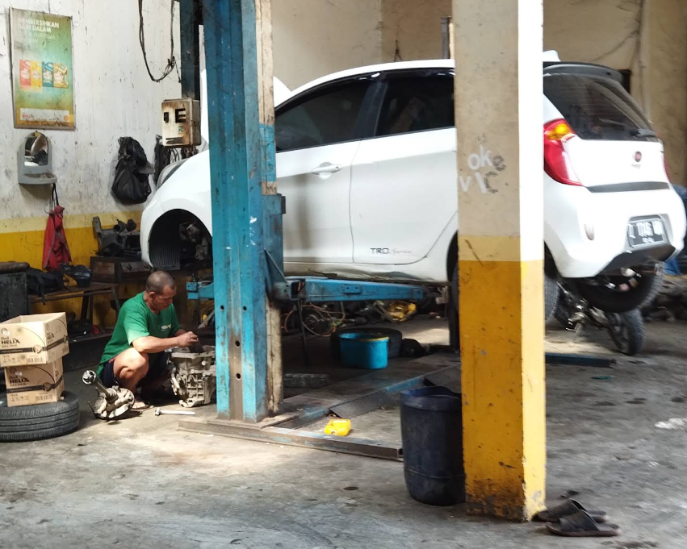

Dari semua pekerjaan perawatan mobil, ganti oli adalah yang paling sering, paling murah, dan paling sering ditunda. Padahal oli adalah pelindung utama mesin: ia melapisi komponen logam yang bergerak cepat, menurunkan suhu, dan membawa kotoran menjauh dari bagian dalam mesin. Oli yang lewat jadwal menipis kemampuannya, dan gesekan logam-ke-logam mulai terjadi.

Jadi kapan seharusnya ganti oli? Jawabannya bertingkat, dari yang paling pasti sampai tanda darurat.

## Acuan Utama: Buku Manual Mobil Anda

Setiap pabrikan mencantumkan interval ganti oli di buku manual, dan itu acuan pertama yang paling aman. Intervalnya berbeda antar tipe mobil dan jenis oli, kadang bahkan berbeda antara "pemakaian normal" dan "pemakaian berat" seperti macet terus-menerus atau jalan pendek berulang.

Kebiasaan berkendara di kota seperti Bandung, yang ramai dan banyak berhenti-jalan, termasuk pemakaian berat menurut definisi kebanyakan pabrikan. Kalau mobil Anda sering begitu, sebaiknya ambil interval yang lebih pendek.

## Gambaran Umum Jarak Ganti Oli

Sebagai gambaran, bukan aturan baku:

- **Oli mineral**: umumnya sekitar 3.000 sampai 5.000 km
- **Oli semi sintetis**: sekitar 5.000 sampai 8.000 km
- **Oli full sintetis**: bisa sampai 7.500 sampai 10.000 km

Bagi mobil yang jarang dipakai, jarak kilometer mungkin lama tercapai, tapi oli tetap menua. Angka yang sering dipakai: ganti setiap 3 sampai 6 bulan meski kilometer belum jalan. Oli basi kehilangan sifat pelumasnya sama seperti oli jenuh.

## Tanda-Tanda Oli Perlu Diganti

Buku manual hilang atau lupa servis terakhir? Cek sendiri, semua ini bisa dilakukan di garasi:

1. **Warna dan tekstur oli di dipstick**. Oli sehat cenderung cokelat transparan. Oli hitam pekat dan kental sudah jenuh. Kalau levelnya di bawah garis minimum, isi dulu lalu cari tahu di mana bocornya.
2. **Suara mesin lebih kasar atau bising**. Pelumas yang menipis membuat mesin "berisik" di ronjongan rendah.
3. **Lampu indikator oli menyala** di panel. Bisa karena level oli rendah atau tekanan pelumas turun. Jangan dinanti, cek secepatnya.
4. **Konsumsi bahan bakar naik** tanpa perubahan pola nyaman. Mesin yang bergesekan lebih bekerja lebih berat.
5. **Sudah lewat banyak bulan dari servis terakhir**, apa pun kondisi di atas.

## Jangan Lupa Filter Olinya

Ganti oli tanpa mengganti filter itu seperti menuang air bersih ke gelas kotor. Filter oli menyaring kotoran, dan sisa-sisa oli lama yang tertahan di dalamnya akan langsung mencemari oli baru. Karena itu kami selalu menyarankan ganti oli sekaligus filter oli, dan pakai jenis yang sesuai rekomendasi tipe mobil.

## Dua Pertanyaan yang Sering Muncul

**Bolehkah mencampur oli dengan merek atau jenis yang berbeda?**
Sebaiknya tidak dibiasakan. Aditif tiap oli punya formulasi berbeda, dan campuran bisa mengubah sifat pelumasnya. Kalau terpaksa top-up di jalan dengan merek berbeda, itu tetap lebih baik daripada level oli yang terlalu rendah, tapi jadwalkan penggantian penuh lebih dekat dari biasanya.

**Oli bekas dibuang ke mana?**
Oli bekas termasuk limbah berbahaya, jangan dituang ke tanah atau saluran air. Kalau Anda mengganti oli sendiri, tampung di wadah tertutup dan antarkan ke pengelola limbah resmi di kota Anda. Banyak bengkel juga menerima oli bekas untuk penanganan yang benar.

## Ganti Oli di Sinar Surya Auto Care

Layanan [ganti oli dan filter](/layanan) kami mengikuti spesifikasi tipe mobil Anda, dan mekanik kami akan menjelaskan pilihan olinya sebelum dikerjakan. Bengkel kami ada di Jl. Cijagra No. 8, Bojongsoang, buka Senin sampai Sabtu jam 07.00 sampai 17.00.

Kalau ragu jenis oli yang cocok atau mau hitung-hitungan kapan ganti berikutnya, [chat WhatsApp kami](https://wa.me/628122022203?text=Halo%20Sinar%20Surya%20Auto%20Care%20yang%20lokasinya%20di%20Jl.%20Cijagra%20No.%208%2C%20Bojongsoang%2C%20Kab.%20Bandung.%20Mau%20ganti%20oli%20dan%20filter%20untuk%20mobil%20saya.%20Estimasi%20biayanya%20berapa%20ya%3F) dulu saja, beserta tipe mobilnya. Kami bantu jawab sebelum Anda datang.
