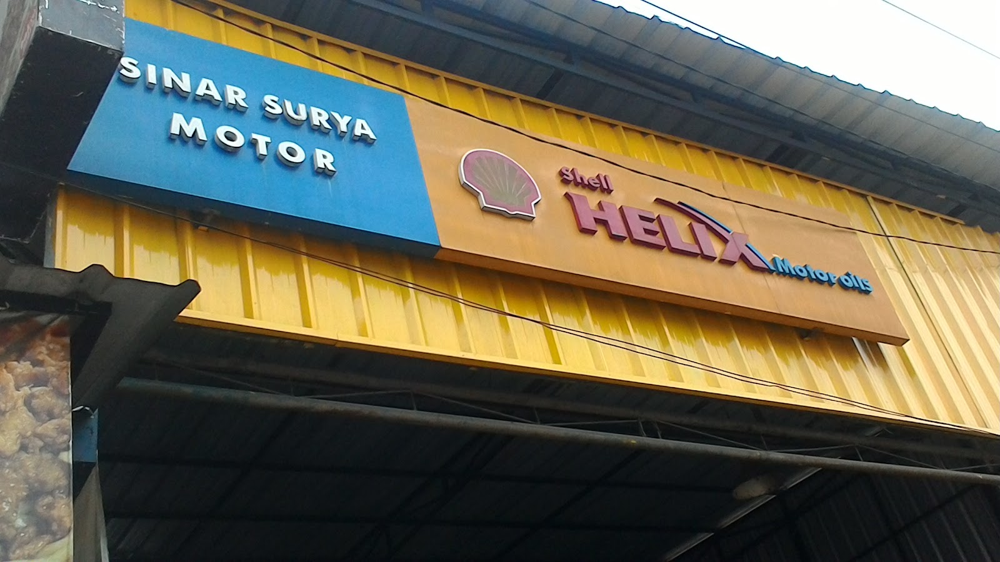

Ketika mobil tiba-tiba bermasalah atau tinggal beberapa hari sebelum perjalanan jauh, hampir semua orang mengetik hal yang sama di Google: "bengkel mobil terdekat". Hasilnya selalu banyak, dan di situlah masalahnya. Dekat itu mudah dilihat, tapi terpercaya tidak tercermin dari jarak.

Lima cek berikut bisa menyingkirkan ragu-ragu itu dalam beberapa menit, sebelum Anda menitipkan mobil ke mana pun.

## 1. Baca Ulasan Google-nya, Jangan Cuma Ratingnya

Angka rating besar itu bagus, tapi yang lebih jujur adalah isi ulasannya. Perhatikan tiga hal:

- **Jumlah ulasan**. Rating 4,7 dari 96 ulasan jauh lebih bisa dipercaya daripada 5,0 dari 3 ulasan.
- **Pola pujian**. Kalau banyak orang berbeda memuji hal yang sama (misalnya hasil cuci yang bersih atau sikap petugasnya yang ramah), itu kebiasaan bengkel, bukan kebetulan.
- **Cara bengkel menanggapi ulasan yang kritis**. Bengkel yang menghargai pelanggan biasanya menjawab dengan tenang dan jelas.

Ulasan di [halaman ulasan kami](/ulasan) diambil langsung dari profil Google Maps bengkel, bukan kutipan yang kami susun sendiri. Angkanya 4,7 dari 96 ulasan per akhir Oktober 2026 dan terus berjalan.

## 2. Cek Kelengkapan Layanan dan Alatnya

Bengkel yang serius dengan pekerjaannya kelihatan dari fasilitasnya. Lift hidrolik, ruang kerja yang tertata, dan daftar layanan yang jelas. Kalau kebutuhan Anda beragam, dari servis rutin sampai cuci kolong, pilih yang bisa menangani semuanya supaya mobil tidak harus bolak-balik ke tempat berbeda. Daftar lengkap [layanan kami](/layanan) ada di halaman tersendiri, termasuk cuci hidrolik dengan lift yang menjangkau bagian kolong.

## 3. Perhatikan Cara Mereka Menjelaskan Kerusakan

Ini pembeda terbesar antara bengkel yang nyaman dan yang bikin waswas. Bengkel yang baik akan:

- Mendengarkan keluhan Anda dulu, bukan langsung menebak
- Menjelaskan temuan dan pengerjaannya dengan bahasa yang bisa dipahami orang awam
- Memberi estimasi sebelum kerja, bukan setelah mobil sudah bongkar

Kalau sejak chat pertama jawabannya mengambang atau maksa, itu sinyal yang sah untuk mencari tempat lain.

## 4. Pastikan Jam Buka dan Lokasinya Realistis

"Bengkel terdekat" yang tutup saat Anda baru selesai kerja tidak terlalu membantu. Cek jam operasionalnya, dan ingat sebagian bengkel punya jam berbeda antara servis dan pencucian. Lokasinya juga, pastikan jalannya masuk akal dari rutinitas Anda: dekat rumah, kantor, atau rute harian.

Kami ada di Jl. Cijagra No. 8, Bojongsoang, mudah dijangkau dari Dayeuhkolot, Baleendah, Buahbatu, dan Bandung Selatan. Servis dan perbaikan buka Senin sampai Sabtu jam 07.00 sampai 17.00, sementara cuci hidrolik buka setiap hari dengan jam lebih pendek di hari Minggu.

## 5. Tanya Dulu Lewat Chat Sebelum Datang

Cara paling murah menguji bengkel baru: chat dulu. Ceritakan keluhan dan tipe mobilnya, lalu lihat jawabannya. Bengkel yang siap melayani akan menjawab dengan informatif, bukan asal menyuruh datang. Dari percakapan itu Anda sudah bisa menilai sikapnya sebelum mengeluarkan tenaga dan bensin.

Alur [booking di tempat kami](/#kontak) memang seperti itu: chat WhatsApp, konsultasi dan estimasi, baru datang sesuai jadwal yang disepakati. Nomor WhatsApp kami ada di bagian kontak, dan Anda bisa mulai dengan pertanyaan sesederhana apa pun.

## Tanda Bengkel yang Sebaiknya Dihindari

Kebalikan dari lima cek di atas juga jadi petunjuk. Waspadai bila:

- Pertanyaan sederhana dijawab dengan "datang aja langsung", tanpa satu kalimat penjelasan pun.
- Kerusakan langsung dinyatakan parah sebelum mobil diperiksa, lengkap dengan daftar penggantian panjang sekaligus.
- Tidak ada kejelasan berapa lama pengerjaannya dan komponen apa saja yang akan diganti.
- Ulasannya sedikit tapi rating penuh, atau teks ulasannya serupa sekali sehingga terkesan dibuat-buat.

Satu-satunya pengaman Anda adalah informasi yang lengkap sebelum setuju. Bengkel yang jujur tidak keberatan memberikannya lebih dulu.

## Terdekat dan Bisa Dipercaya Bisa Duanya

Mencari bengkel mobil terdekat bukan berarti mengorbankan kepercayaan. Lima cek di atas cuma butuh belasan menit, tapi menyelamatkan Anda dari pengerjaan yang salah sasaran. Mulailah dari ulasannya, dan biarkan cara bengkel itu menjawab chat pertama Anda yang jadi penentu.
