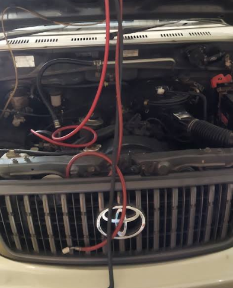

Mobil yang dipakai setiap hari jarang bermasalah secara mendadak. Yang lebih sering terjadi, kerusakan besar dimulai dari hal kecil yang tertunda: oli yang lewat jadwal, tekanan ban yang tidak pernah dicek, atau filter yang mampet pelan-pelan. Kabar baiknya, mencegah semuanya tidak rumit. Cukup perawatan rutin yang jalan konsisten.

Panduan ini merangkum jadwal perawatan yang kami anjurkan ke pelanggan di [bengkel kami di Bojongsoang](/), dari cek ringan yang bisa Anda lakukan sendiri sampai servis berkala di bengkel.

## Cek Ringan yang Bisa Dilakukan Sendiri

Beberapa hal di bawah ini hanya butuh beberapa menit, tapi efeknya besar untuk keselamatan dan kantong Anda:

- **Tekanan ban**, sekali seminggu atau sebelum perjalanan jauh. Ban kurang angin bikin bahan bakar boros dan ban aus tidak rata.
- **Lampu-lampu**, dari lampu utama, rem, sampai sein. Mudah dilewatkan karena kita tidak melihat mobil sendiri dari luar setiap hari.
- **Cairan wiper dan kondisi wiper**. Kadar air hujan Bandung tinggi, wiper yang mulai kaku langsung terasa saat gerimis.
- **Level oli mesin** lewat dipstick, minimal dua minggu sekali. Pastikan mobil dalam kondisi datar saat mengecek.
- **Aki dan kelistrikan** jika starter terasa berat, terutama di pagi hari.

## Perawatan Berkala di Bengkel

Selain cek ringan, ada pekerjaan yang sebaiknya ditangani bengkel dengan alat lengkap:

1. **Ganti oli dan filter oli**. Jaraknya mengikuti rekomendasi pabrikan di buku manual mobil Anda. Untuk pemakaian harian di perkotaan yang sering macet, jadwal berbasis waktu (misalnya setiap beberapa bulan) juga perlu diperhatikan meski kilometer belum tercapai.
2. **Servis rutin dan tune up**. Pemeriksaan busi, filter udara, dan kondisi mesin secara menyeluruh agar konsumsi bahan bakar tetap hemat.
3. **Pemeriksaan rem dan kaki-kaki**. Kampas rem, shockbreaker, dan bushing bekerja diam-diam; kondisinya baru terasa saat sudah parah kalau tidak diperiksa rutin.
4. **Service AC mobil**, termasuk filter kabin, biasanya setahun sekali atau saat kabin mulai kurang sejuk.
5. **Pemeriksaan kelistrikan dan aki**, terutama menjelang musim hujan.

## Ceklis Perawatan Rutin

Ringkasannya, ini urutan yang bisa Anda tempel di garasi:

- [ ] Tiap minggu: tekanan ban, lampu, air wiper
- [ ] Tiap dua minggu: level oli mesin
- [ ] Sesuai jadwal manual: ganti oli + filter oli
- [ ] Setiap 6 bulan: pengecekan rem, kaki-kaki, dan kelistrikan
- [ ] Tiap tahun: service AC dan filter kabin
- [ ] Sebelum mudik atau perjalanan jauh: check-up menyeluruh

## Tanda Mobil Perlu Segera Dibawa ke Bengkel

Jangan tunggu jadwal bila muncul tanda-tanda ini:

- Ada bunyi aneh saat mengerem, berbelok, atau melewati jalan bergelombang
- Lampu indikator oli, mesin, atau aki menyala di panel
- Starter berat atau mesin sulit hidup pagi hari
- Konsumsi bahan bakar naik tanpa perubahan pola nyaman
- Ada genangan cairan di bawah mobil setelah parkir

## Kesalahan Perawatan yang Sering Terjadi

Dari yang kami temui di bengkel, empat kebiasaan ini paling sering memperpendek umur komponen:

- **Menunda begitu lampu indikator menyala** karena mobil "masih bisa jalan". Beberapa kerusakan berkembang cepat begitu peringatan diabaikan, dan yang tadinya ringan jadi mahal.
- **Cuci bodi rutin tapi kolong tidak pernah dibersihkan**. Kotoran bagian bawah menumpuk bertahun-tahun tanpa terlihat, dan itulah pekerjaan [cuci hidrolik](/blog/apa-itu-cuci-mobil-hidrolik).
- **Tekanan ban diisi asal-asalan**. Terlalu keras membuat mobil goyang dan ban aus di bagian tengah, terlalu lembut membuat boros dan ban aus di pinggir.
- **Menganggap bengkel hanya perlu saat mobil bermasalah**. Servis preventif selalu lebih murah daripada perbaikan, apalagi kalau kerusakan menyeret komponen lain.

## Kalau Tidak Punya Waktu, Kami Bantu

Sinar Surya Auto Care menangani [servis rutin, ganti oli, service AC, kaki-kaki, dan kelistrikan](/layanan) di satu tempat di Jl. Cijagra No. 8, Bojongsoang. Servis dan perbaikan buka Senin sampai Sabtu jam 07.00 sampai 17.00, sementara cuci hidrolik buka setiap hari.

Cukup [chat WhatsApp](https://wa.me/628122022203?text=Halo%20Sinar%20Surya%20Auto%20Care%20yang%20lokasinya%20di%20Jl.%20Cijagra%20No.%208%2C%20Bojongsoang%2C%20Kab.%20Bandung.%20Mobil%20saya%20mau%20servis%20rutin%20dan%20tune%20up.%20Bisa%20tanya%20estimasi%20waktunya%3F) untuk tanya-tanya dulu. Kami dengar keluhannya, cek kondisi mobil, lalu jelaskan estimasi pengerjaannya sebelum Anda datang.
