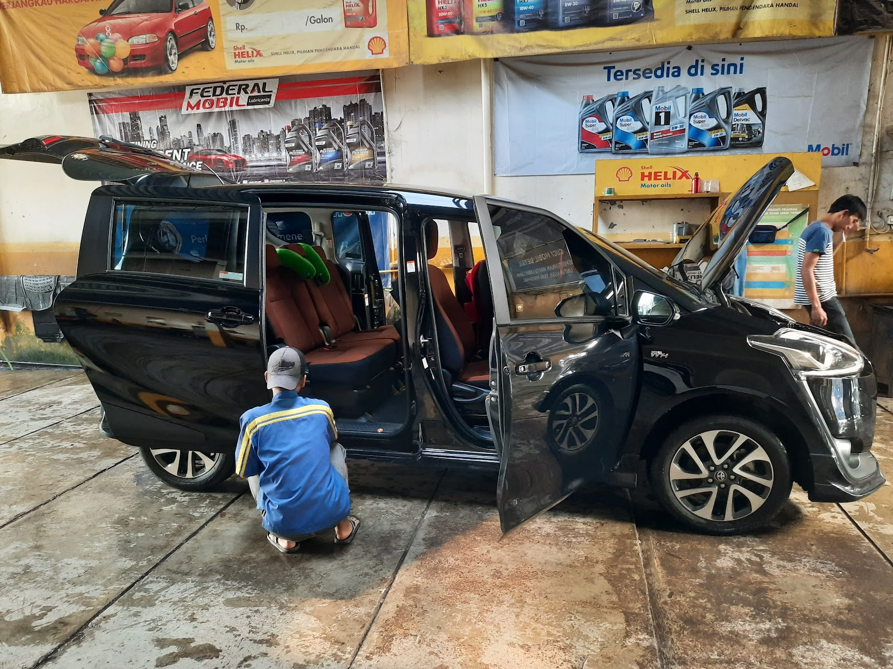

AC mobil bukan sekadar kenyamanan. Di macet panas, AC menentukan fokus berkendara, dan di musim hujan ia berperan mengeringkan kabin supaya kaca tidak buram. Masalahnya, AC rusak hampir tidak pernah tiba-tiba. Selalu ada tanda-tanda awal yang muncul berminggu-minggu sebelum akhirnya benar-benar mati.

Kalau satu dari lima tanda berikut muncul, jadwalkan service AC mobil Anda. Semakin awal ditangani, umumnya biayanya juga semakin ringan.

## 1. Kurang Dingin atau Dinginnya Lama Sekali

Tanda paling umum. Ventilasi masih menghembus, tapi hembusannya tidak sedingin dulu, atau butuh waktu lama baru terasa. Penyebabnya bervariasi: freon berkurang karena bocor perlahan, kondensor kotor sehingga pembuangan panas kurang maksimal, sampai kompresor yang mulai melemah. Hanya pemeriksaan tekanan yang bisa memastikan penyebabnya, jadi jangan langsung menebak isi freon.

## 2. Bau Apek Saat Dinyalakan

Bau lembap atau apek dari ventilasi biasanya berasal dari evaporator yang kotor. Sisa air dan kelembapan di evaporator menjadi tempat tumbuh jamur dan bakteri. Selain mengganggu, udara bau itu dihirup terus oleh penumpang. Solusinya cuci AC untuk membersihkan evaporator, biasanya sekaligus mengganti filter kabin.

## 3. Suara Aneh Saat Kompresor Aktif

Bunyi berdecit, dengung, atau ketukan yang muncul hanya saat AC dinyalakan layak dicurigai. Bisa dari bearing kompresor yang aus, magnet kopling yang lemah, sampai kipas kondensor yang mulai rusak. Suara jenis ini jarang sembuh sendiri, dan kalau dibiarkan bisa merusak komponen yang lebih mahal.

## 4. Kaca Berembun dan Kabin Terasa Lembap

AC juga bertugas menghisap kelembapan dari kabin. Kalau kaca depan sulit kering walau wiper dan AC jalan, atau ada aroma pengap di kabin, kemampuan dehumidifier AC sudah menurun. Pada kondisi hujan seperti di Bandung, kabin lembap membuat kaca buram dan menurunkan visibilitas, jadi ini termasuk tanda yang tidak boleh ditunda.

## 5. Ada Rembesan Air ke Dalam Kabin

Tetes-tetes air di bawah mobil saat AC menyala itu normal, itu pembuangan kondensat. Yang tidak normal adalah air masuk ke lantai kabin atau menggenang di bawah dashboard. Biasanya selang pembuangan buntu, dan bila dibiarkan karpet basah terus, bisa memicu karat dan bau tidak sedap.

## Kebiasaan yang Membantu AC Awet

Service AC bisa ditunda lebih lama kalau kebiasaan harian Anda mendukung:

- Ganti filter kabin sesuai jadwal. Filter mampet membuat hembusan lemah dan kabin cepat bau.
- Cuci AC setahun sekali meski belum ada gejala, untuk mencegah jamur menempel di evaporator.
- Jangan set suhu paling dingin dengan kipas paling besar terus-menerus. Perbedaan suhu kabin dan luar yang terlalu ekstrem membuat AC bekerja lebih berat, dan tubuh Anda juga kaget tiap keluar mobil.
- Beberapa menit sebelum mesin dimatikan, kurangi dulu dinginnya dan biarkan kipas berjalan. Sisa air di evaporator ikut kering, sehingga tidak jadi sarang bau apek.

## Apa Saja yang Dikerjakan Saat Service AC?

Lingkup [service AC mobil](/layanan) di tempat kami menyesuaikan hasil pemeriksaan awal, mulai dari yang ringan sampai perbaikan:

- Cek tekanan freon dan cari kebocorannya bila ada
- Cuci AC: membersihkan evaporator, kondensor, dan saluran pembuangan
- Ganti filter kabin
- Perbaikan atau penggantian komponen seperti magnet kopling dan kompresor bila memang diperlukan

Mekanik kami akan menjelaskan dulu apa yang ditemukan dan estimasi pengerjaannya, baru dikerjakan setelah Anda setuju.

## Cek AC Sekalian Servis Rutin

Service AC bisa jalan beriringan dengan servis rutin, jadi Anda tidak perlu datang dua kali. Sinar Surya Auto Care ada di Jl. Cijagra No. 8, Bojongsoang, buka Senin sampai Sabtu jam 07.00 sampai 17.00.

Ceritakan gejalanya lewat [WhatsApp kami](https://wa.me/628122022203?text=Halo%20Sinar%20Surya%20Auto%20Care%20yang%20lokasinya%20di%20Jl.%20Cijagra%20No.%208%2C%20Bojongsoang%2C%20Kab.%20Bandung.%20AC%20mobil%20saya%20kurang%20dingin.%20Boleh%20tanya%20estimasi%20service%20AC%3F), misalnya "kurang dingin sejak kemarin" atau "bau saat dinyalakan". Dari gejalanya, kami bisa perkirakan dulu arah pemeriksaannya sebelum mobil datang.
